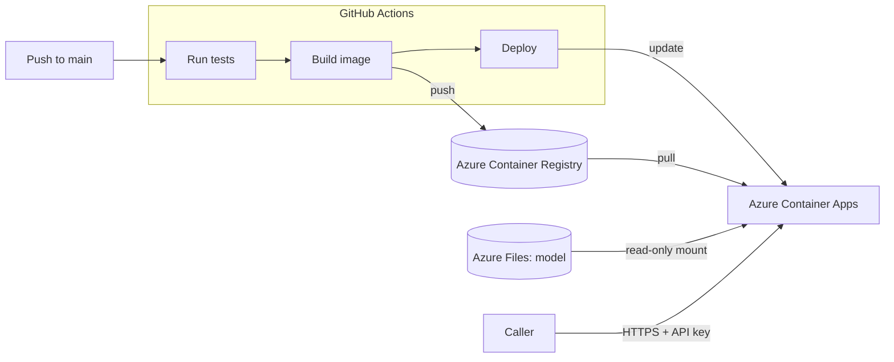

# Explainable Similarity API

[](https://github.com/AshwiniKmrj/explainable-similarity/actions/workflows/ci.yml)

A REST API that tells you how similar two texts are and **why**: alongside the similarity score, it names the
topics the texts share and the topics on which they differ.

**[Try the live API docs](https://explainable-similarity.happycoast-a12a48ab.francecentral.azurecontainerapps.io/docs)**

The docs are public; running a comparison needs an API key. The service sleeps when idle, so the first request
after a quiet period takes about half a minute.

## Example

Two texts that are both about artificial intelligence, one in medicine and one in law.

**Text A**

> Hospitals are starting to use artificial intelligence to read X-rays and MRI scans. In recent trials the
> software detected early signs of lung cancer that radiologists had missed, which could help doctors begin
> treatment sooner.

**Text B**

> Lawmakers are debating how to regulate artificial intelligence. A proposed law would require companies to
> disclose how their algorithms make decisions and would let courts fine firms whose systems discriminate
> against citizens.

**Response from `POST /similarity/explain`** (numbers shortened to four decimals, truncation flags left out):

```json
{
  "similarity": 0.4370,
  "shared_topics": [
    { "topic": "Computing and Software Technology", "contribution": 0.4533 }
  ],
  "differing_topics": [
    { "topic": "Social Movement and Activism", "contribution": -0.0383 },
    { "topic": "Legal Framework and Regulation", "contribution": -0.0239 },
    { "topic": "Medical Healthcare Services", "contribution": -0.0167 }
  ]
}
```

- **What they share:** both texts are about AI, so "Computing and Software Technology" alone carries 45% of the
  topic-level signal.
- **Where they differ:** one text is about healthcare, the other about law and citizens' rights. Those topics
  have negative contributions, meaning they pull the similarity down.
- **The score** of 0.44 reflects that: one strong common subject, applied in two different fields.

## How it works

The service uses neural text embeddings in which certain dimensions each correspond to one particular topic.
For example, one dimension stands for football and another for banking.

Cosine similarity is a sum of per-dimension products, so it can be decomposed to isolate each topic's
contribution. A topic contributes positively when both texts are about it and negatively when they differ on it.

The model is private and is not part of this repository.

## Architecture



- **CI/CD:** every push to `main` is tested, built into a Docker image and deployed. A version that fails its
  tests or cannot start never replaces the running one.
- **No stored cloud passwords:** GitHub signs in to Azure with OpenID Connect, using an identity that may only
  push images and update this one app.

## Security

- API-key authentication, per-caller rate limiting and a request size limit.
- Submitted texts are never echoed in error responses or written to logs, and the test suite checks this.
- Dependencies are pinned, including the third-party model code loaded at start.
- The container runs as a non-root user and contains no model and no secrets.

## Tech stack

Python, FastAPI, Pydantic, sentence-transformers, PyTorch, pytest, Docker, GitHub Actions, Azure Container Apps,
Azure Container Registry, Azure Files.
