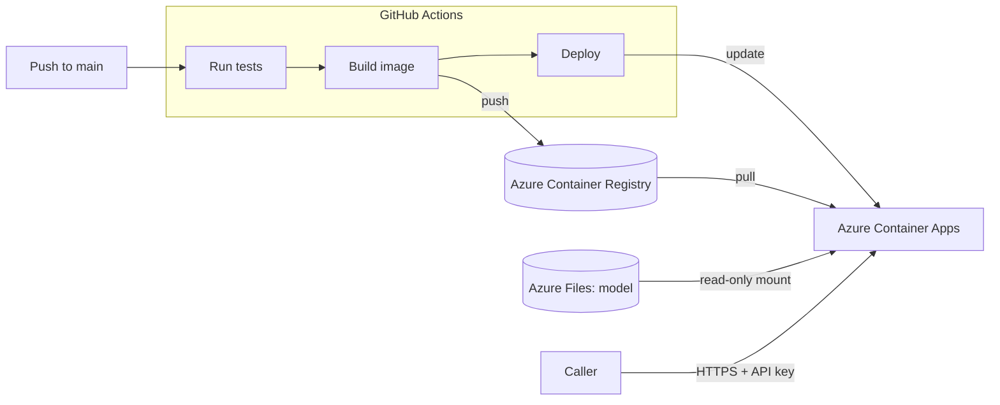

# Explainable Similarity API

[](https://github.com/AshwiniKmrj/explainable-similarity/actions/workflows/ci.yml)

A REST API that tells you how similar two texts are and **why**: alongside the similarity score, it names the
topics the texts share and the topics on which they differ.

**[Try the live API docs](https://explainable-similarity.happycoast-a12a48ab.francecentral.azurecontainerapps.io/docs)**

The docs are public; running a comparison needs an API key. The service sleeps when idle, so the first request
after a quiet period takes about half a minute.

## Example

Two texts that are both about artificial intelligence, one in medicine and one in law.

**Request**

```http
POST /similarity/explain
X-API-Key: <your-key>
Content-Type: application/json
```

```json
{
  "text_a": "Hospitals are starting to use artificial intelligence to read X-rays and MRI scans. In recent trials the software detected early signs of lung cancer that radiologists had missed, which could help doctors begin treatment sooner.",
  "text_b": "Lawmakers are debating how to regulate artificial intelligence. A proposed law would require companies to disclose how their algorithms make decisions and would let courts fine firms whose systems discriminate against citizens.",
  "top_shared": 1,
  "top_differing": 3
}
```

**Response** (numbers shortened to four decimals)

```json
{
  "similarity": 0.4370,
  "text_a_truncated": false,
  "text_b_truncated": false,
  "shared_topics": [
    { "topic": "Computing and Software Technology", "contribution": 0.4533 }
  ],
  "differing_topics": [
    { "topic": "Social Movement and Activism", "contribution": -0.0383 },
    { "topic": "Legal Framework and Regulation", "contribution": -0.0239 },
    { "topic": "Medical Healthcare Services", "contribution": -0.0167 }
  ]
}
```

- **What they share:** both texts are about AI, so "Computing and Software Technology" alone carries 45% of the
  topic-level signal.
- **Where they differ:** one text is about healthcare, the other about law and citizens' rights. Those topics
  have negative contributions, meaning they pull the similarity down.
- **The score** of 0.44 reflects that: one strong common subject, applied in two different fields.

Add `"include_summary": true` to the request and each topic also comes with a description of what it covers.
For example, for "Legal Framework and Regulation":

> This topic represents documents related to the creation, interpretation, and application of laws, regulations,
> and rules. [...]

## Using the API

Both endpoints take a JSON body and need the API key in an `X-API-Key` header.

### `POST /similarity`

Returns only the similarity score.

```bash
curl -X POST https://<host>/similarity \
  -H "X-API-Key: <your-key>" \
  -H "Content-Type: application/json" \
  -d '{"text_a": "First text", "text_b": "Second text"}'
```

### `POST /similarity/explain`

Returns the score plus the topics behind it. It takes the same two texts and three optional settings:

| Field | Required | Default | Meaning |
|---|---|---|---|
| `text_a`, `text_b` | yes | | The two texts to compare, up to 4000 characters each |
| `top_shared` | no | `2` | How many shared topics to return, 0 to 10 |
| `top_differing` | no | `2` | How many differing topics to return, 0 to 10 |
| `include_summary` | no | `false` | Set to `true` to get a description of each topic |

### What comes back

| Field | Returned by | Meaning |
|---|---|---|
| `similarity` | `/similarity`, `/similarity/explain` | Cosine similarity score |
| `text_a_truncated`, `text_b_truncated` | `/similarity`, `/similarity/explain` | `true` if a text was too long for the model and its end was ignored |
| `shared_topics` | `/similarity/explain` | The topics with highest contribution to cosine similarity in descending order |
| `differing_topics` | `/similarity/explain` | The topics on which the texts point in opposite directions, in ascending order of contribution (most negative first) |
| `contribution` | `/similarity/explain` | Given for each topic: how large its contribution to the cosine similarity is compared to all topics in the model, as a percentage. 0.45 means this topic accounts for 45% of what all topics contribute together. A higher percentage means the topic is more strongly present in both texts, contributing more to their similarity. |
| `summary` | `/similarity/explain` | Given for each topic if `include_summary` is `true`: a description of what the topic covers |


## How it works

The service embeds both texts with a transformer-based sentence embedding model. The model is partly interpretable: some of its embedding dimensions each correspond to one topic, for example one dimension for football and another for banking.

Cosine similarity is the normalised sum of per-dimension products, so it can be decomposed to isolate each topic's
contribution based on its dimension values. A topic or a dimension contributes positively when both texts are about it and negatively when they differ on it.

The model is private and is not part of this repository.

## Architecture



- **CI/CD:** every push to `main` is tested, built into a Docker image and deployed. A version that fails its
  tests or cannot start never replaces the running one.
- **No stored cloud passwords:** GitHub signs in to Azure with OpenID Connect, using an identity that may only
  push images and update this one app.

## Performance

| Measurement | p50 | p95 |
|---|---|---|
| Paragraph-length texts (about 230 characters each) | 206 ms | 243 ms |
| Maximum-length texts (4000 characters each) | 1.8 s | 1.9 s |
| Cold start (first request after an idle period) | about 34 s | |

Measured end to end, one request at a time, on 2 CPUs without a GPU.

## Security

- API-key authentication, per-caller rate limiting and a request size limit.
- Submitted texts are never echoed in error responses or written to logs, and the test suite checks this.
- Dependencies are pinned, including the third-party model code loaded at start.
- The container runs as a non-root user and contains no model and no secrets.

## Tech stack

Python, FastAPI, Pydantic, sentence-transformers, PyTorch, pytest, Docker, GitHub Actions, Azure Container Apps,
Azure Container Registry, Azure Files.
